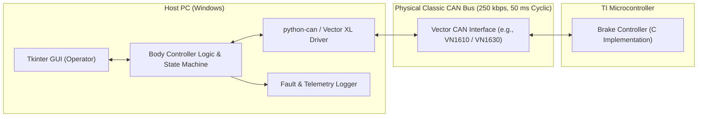
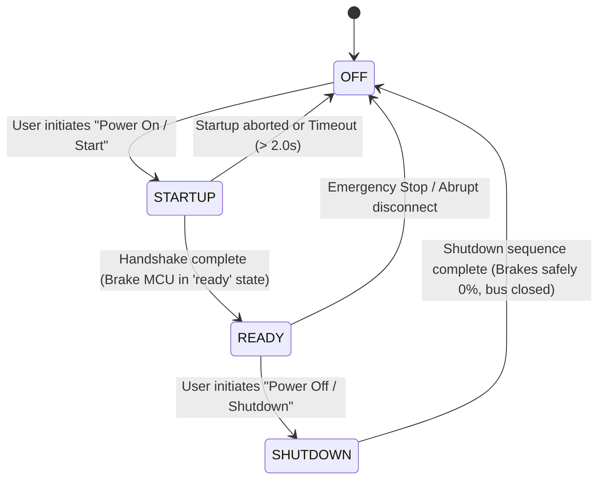
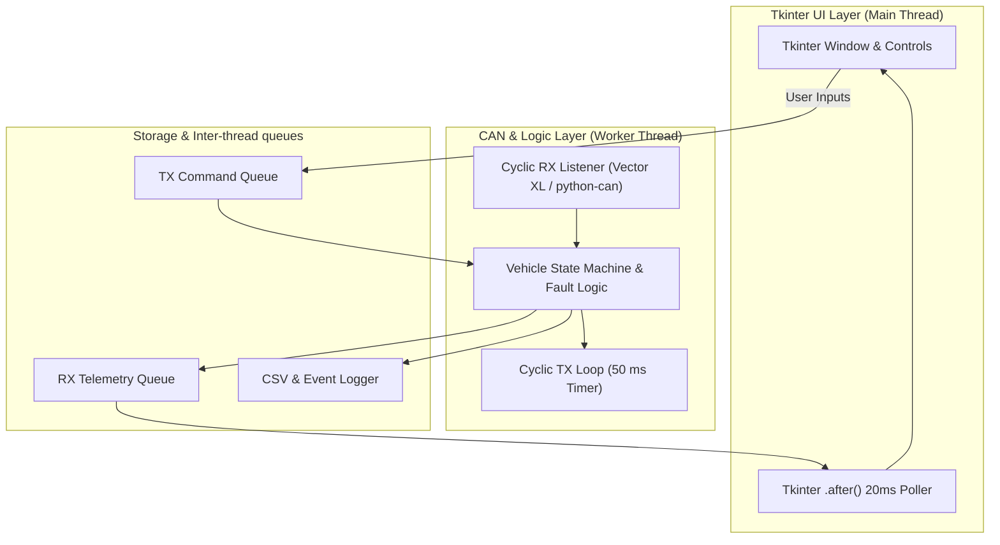

# Vehicle Body Controller Software Requirements Specification (body.md)

| Document Version | Status | Reference Baseline |
| :--- | :--- | :--- |
| 1.0.0 | Draft / Baseline | [constitution.md](file:///d:/projects/Agents/simbodybrake/constitution.md), [icd.md](file:///d:/projects/Agents/simbodybrake/icd.md), [brake.md](file:///d:/projects/Agents/simbodybrake/brake.md) |

---

## 1. System Overview & Scope

The **Vehicle Body Controller (BC)** is a PC-based software application implemented in Python. It acts as the supervisory system and human-machine interface (HMI) for the simulated vehicle braking system. The Body Controller communicates over a physical Classic CAN bus with an external Brake Controller implemented in C and executing on a Texas Instruments (TI) microcontroller.



### 1.1 Requirements Hierarchy & Traceability
All requirements in this document trace directly to the high-level goals defined in [constitution.md](file:///d:/projects/Agents/simbodybrake/constitution.md). Requirements are prefixed with `REQ-BC-`.

---

## 2. Hardware, Environment & Communication Baseline

| Parameter | Specification | Notes |
| :--- | :--- | :--- |
| **Host Environment** | Windows 10/11 x64, Python 3.10+ | Workstation runtime |
| **GUI Framework** | Python `Tkinter` (Standard Library) | Responsive, zero-heavy-dependency GUI |
| **CAN Hardware Interface** | Vector Informatik CAN Hardware | E.g., VN1610, VN1630, VN5620, or CANcardXL |
| **CAN Driver API** | Vector XL Driver Library (`vxlapi.dll`) | Accessed via `python-can` (`interface='vector'`) |
| **CAN Protocol** | Classic CAN (CAN 2.0B, 11-bit Standard Identifiers) | Max 8 bytes payload per frame |
| **Baud Rate** | **250 kbps** (250,000 bps) | Nominal bit timing |
| **Message Cycle Rate** | **50 ms** periodic refresh rate (\(20\text{ Hz}\)) | Both transmit and receive cyclic timing |

### 2.1 Hardware Interface Requirements
- **REQ-BC-HW-001**: The Body Controller shall utilize the Vector XL API (via `python-can` or native wrapper) to initialize and access the connected Vector CAN channel.
- **REQ-BC-HW-002**: The application shall configure the CAN controller to **250 kbps** baud rate with standard 11-bit identifiers.
- **REQ-BC-HW-003**: The application shall provide an automated fallback to a virtual/mock channel (e.g., `virtual` interface in `python-can`) if no Vector hardware or channel license is detected, alerting the user while allowing offline UI and state machine simulation.

---

## 3. Vehicle State Machine Requirements

The Body Controller shall implement the top-level Vehicle State Machine with four core operational states: `OFF`, `STARTUP`, `READY`, and `SHUTDOWN`.



### 3.1 State Definitions & Behavior
- **REQ-BC-STATE-001 (OFF)**:
  - Default initial state upon application launch.
  - No active brake commands shall be sent (\(0\%\) command).
  - Vehicle state signal on CAN bus shall report `OFF`.
- **REQ-BC-STATE-002 (STARTUP)**:
  - Triggered by operator action ("Start / Power On").
  - The Body Controller shall broadcast vehicle state `STARTUP` over CAN.
  - The controller shall evaluate feedback from the Brake Controller. The vehicle shall transition to `READY` only when the Brake Controller reports its state as `ready` (after completing its `wakeup` and `checks` states).
  - If the Brake Controller fails to report `ready` within \(2000\text{ ms}\), the Body Controller shall declare a startup fault and return to `OFF`.
- **REQ-BC-STATE-003 (READY)**:
  - Normal operational state.
  - The operator is permitted to issue dynamic brake commands (\(0\%\text{ -- }100\%\)).
  - Vehicle state signal on CAN bus shall report `READY`.
- **REQ-BC-STATE-004 (SHUTDOWN)**:
  - Triggered by operator action ("Shutdown / Power Off") from `READY`.
  - The Body Controller shall automatically ramp down any active brake command to \(0\%\).
  - The controller shall broadcast vehicle state `SHUTDOWN` for a minimum of \(500\text{ ms}\) (10 cycles) before transitioning cleanly to `OFF`.

---

## 4. User Interface (Tkinter) Requirements

The user interface shall be implemented using Python's standard `Tkinter` library, organized with an intuitive control layout, live telemetry visualization, and prominent safety/fault banners.

```
+-------------------------------------------------------------------------------+
|                      VEHICLE BODY CONTROLLER (TKINTER)                        |
+-------------------------------------------------------------------------------+
|  CAN Link: [ ACTIVE (Vector VN1610 - Ch 1 @ 250k) ]   Cycle: 50 ms            |
+-------------------------------------------------------------------------------+
|  VEHICLE STATE CONTROL                    BRAKE CONTROLLER STATUS             |
|  Current State: [ READY ]                 MCU State:    [ READY / BRAKING ]   |
|  [ Power On ]  [ Shutdown ]  [ ESTOP ]    Measured P:   [ 45.2 psi ]          |
|                                           Target P:     [ 45.0 psi ]          |
+-------------------------------------------------------------------------------+
|  ENVIRONMENT SETTINGS                                                         |
|  Ambient Temp: [ - ]  25  [ + ] deg C   (Range: -40 to 85 deg C)              |
+-------------------------------------------------------------------------------+
|  BRAKE COMMAND INTERFACE                                                      |
|  [ Apply Brakes (100%) ]  [ Release Brakes (0%) ]                             |
|  Slider: [====|============== ]  45 %                                         |
+-------------------------------------------------------------------------------+
|  [!] SYSTEM WARNINGS & ALARMS                                                 |
|  [ WARNING: Brake in DEGRADED mode - Reduced Capacity (Max: 80.0 psi) ]       |
|  [ FAULT STATUS: Normal / No Critical Fault ]                                 |
+-------------------------------------------------------------------------------+
|  EVENT & FAULT LOGGING PREVIEW                                                |
|  12:08:44.120 [INFO] State changed: STARTUP -> READY                          |
|  12:08:45.300 [ENV]  Ambient temperature adjusted to 55 deg C                 |
|  12:08:46.800 [WARN] Received BRK_WarningStatus: REDUCED_CAPACITY (Max 80 psi)|
|  12:08:48.550 [CMD]  Brake target set to 45% (45 psi)                         |
+-------------------------------------------------------------------------------+
```

### 4.1 UI Component Requirements
- **REQ-BC-UI-001 (Framework)**: The GUI shall be implemented in Python using `Tkinter` and `ttk` themed widgets.
- **REQ-BC-UI-002 (Thread Isolation)**: The Tkinter main thread (`mainloop`) shall remain decoupled from the CAN transmission/reception loop using dedicated background threads and thread-safe queues (`queue.Queue`) to prevent GUI freezing.
- **REQ-BC-UI-003 (State Controls)**: The UI shall provide buttons to request state changes:
  - `Power On` (transitions `OFF` $\rightarrow$ `STARTUP`)
  - `Power Off` (transitions `READY` $\rightarrow$ `SHUTDOWN`)
  - `Emergency Stop` (immediately forces command to \(0\%\) or emergency stop hold).
- **REQ-BC-UI-004 (Brake Controls)**:
  - A slider widget allowing granular control from \(0\%\) to \(100\%\) with \(1\%\) resolution.
  - Quick-action buttons: "Apply Brakes" (sets command to \(100\%\)) and "Release Brakes" (sets command to \(0\%\)).
  - Brake input controls shall be disabled/grayed out unless the Vehicle State is `READY`.
- **REQ-BC-UI-005 (Telemetry Display)**:
  - Current Vehicle State (`OFF`, `STARTUP`, `READY`, `SHUTDOWN`).
  - Current Brake Controller State (`wakeup`, `checks`, `ready`, `braking`, `fault`).
  - Commanded Brake % (\(0\%\text{ -- }100\%\)) and corresponding target pressure (\(0\text{ -- }100\text{ psi}\)).
  - Received Actual Brake Pressure (\(\text{psi}\)).
  - Ambient Temperature value ($^{\circ}\text{C}$).
- **REQ-BC-UI-006 (Fault & Alert Banner)**:
  - A prominent status banner that turns red upon critical fault condition (pressure below threshold or microcontroller error flag).
  - The banner shall display human-readable fault descriptions.
  - Note: CAN communication timeout/loss fault detection is excluded from the current scope.
- **REQ-BC-UI-007 (Ambient Temperature Control)**:
  - The UI shall provide an interactive control (e.g., spinbox, entry, or increment/decrement buttons) allowing the operator to view and adjust the ambient temperature in degrees Celsius ($^{\circ}\text{C}$).
  - Supported range: $-40^{\circ}\text{C}$ to $+85^{\circ}\text{C}$ with $1^{\circ}\text{C}$ step resolution.
  - Default value: $25^{\circ}\text{C}$.
  - The operator-selected value shall be published cyclically in the `BC_VehicleState` CAN message.
- **REQ-BC-UI-008 (Brake Degraded State Warning Display)**:
  - The UI shall feature a dedicated Amber/Yellow warning indicator for degraded brake states, visually distinct from the Red critical fault banner.
  - When the Brake Controller broadcasts an active warning frame (`BRK_WarningStatus`), the UI shall prominently display the degraded mode (e.g., `REDUCED_CAPACITY`, `OVERHEATED_DERATING`, `SLOW_RESPONSE`, `BACKUP_CIRCUIT`) and the current maximum available brake pressure in psi.
  - When no degraded warning is active (`WarningActive == 0`), the indicator shall display nominal status.

---

## 5. CAN Interface & Communication Specification (ICD)

Communication between the Body Controller and Brake Controller conforms to Classic CAN with **50 ms** cyclic refresh rates.

### 5.1 CAN Message Matrix

| Msg Name | CAN ID (Std) | Dir | Period | DLC | Purpose |
| :--- | :--- | :--- | :--- | :--- | :--- |
| **`BC_VehicleState`** | `0x100` | BC $\rightarrow$ Brake | 50 ms | 3 | Vehicle state broadcast, ambient temperature & heartbeat |
| **`BC_BrakeCommand`** | `0x101` | BC $\rightarrow$ Brake | 50 ms | 3 | Brake command % and command validation |
| **`BRK_StatusFeedback`** | `0x200` | Brake $\rightarrow$ BC | 50 ms | 4 | Brake state machine and measured pressure |
| **`BRK_FaultStatus`** | `0x201` | Brake $\rightarrow$ BC | 50 ms / On Change | 3 | Microcontroller fault codes and diagnostics |
| **`BRK_WarningStatus`** | `0x202` | Brake $\rightarrow$ BC | 50 ms / On Change | 3 | Brake degraded state warning and capacity limits |

---

### 5.2 Transmit (Tx) Message Definitions

#### Message 1: `BC_VehicleState` (ID: `0x100`)
- **Periodicity**: 50 ms ($\pm 5\text{ ms}$)
- **DLC**: 3 bytes
- **Signals**:
  - `VehicleState` (Byte 0, bits 0-3):
    - `0x0`: `OFF`
    - `0x1`: `STARTUP`
    - `0x2`: `READY`
    - `0x3`: `SHUTDOWN`
    - `0x4 - 0xF`: `RESERVED / INVALID`
  - `BC_Reserved` (Byte 0, bits 4-7): Reserved (set to `0`).
  - `AliveCounter` (Byte 1, bits 0-7): Rolling counter \(0\text{ -- }255\) incremented each 50 ms transmission.
  - `AmbientTemperature` (Byte 2, bits 0-7, signed `int8`):
    - Scale: \(1^{\circ}\text{C/bit}\)
    - Offset: \(0\)
    - Range: \(-40^{\circ}\text{C}\text{ to }+85^{\circ}\text{C}\)
    - Default: \(25^{\circ}\text{C}\)
    - Configured via UI control.

#### Message 2: `BC_BrakeCommand` (ID: `0x101`)
- **Periodicity**: 50 ms ($\pm 5\text{ ms}$)
- **DLC**: 3 bytes
- **Signals**:
  - `BrakeCommandPercent` (Byte 0, bits 0-7):
    - Scale: 1 % per bit
    - Range: \(0\text{ to }100\) (Values \(>100\) capped at 100)
    - Mapping: \(0\% = 0\text{ psi}\), \(100\% = 100\text{ psi}\)
  - `BrakeEnable` (Byte 1, bit 0):
    - `0`: Inactive / Inhibit
    - `1`: Active
  - `RollingCounter` (Byte 2, bits 0-7): Rolling counter \(0\text{ -- }255\).

---

### 5.3 Receive (Rx) Message Definitions

#### Message 3: `BRK_StatusFeedback` (ID: `0x200`)
- **Periodicity**: Expected every 50 ms
- **DLC**: 4 bytes
- **Signals**:
  - `BrakeMachineState` (Byte 0, bits 0-3):
    - `0x0`: `wakeup`
    - `0x1`: `checks`
    - `0x2`: `ready`
    - `0x3`: `braking`
    - `0x4`: `fault`
  - `ActualBrakePressure` (Byte 1-2, 16-bit unsigned integer, Intel Little-Endian):
    - Scale: \(0.1\text{ psi/bit}\)
    - Offset: \(0\)
    - Range: \(0.0\text{ to }120.0\text{ psi}\)
    - Normal full scale corresponds to \(0.0\text{ -- }100.0\text{ psi}\).
  - `BrakeActiveFlag` (Byte 3, bit 0): `1` if mechanical braking applied, `0` if released.

#### Message 4: `BRK_FaultStatus` (ID: `0x201`)
- **Periodicity**: 50 ms (or event-driven on fault change)
- **DLC**: 3 bytes
- **Signals**:
  - `FaultActive` (Byte 0, bit 0): `1` if fault active, `0` if normal.
  - `FaultCode` (Byte 1, bits 0-7):
    - `0x00`: No Fault
    - `0x01`: Sensor Fault (pressure sensor out of range)
    - `0x02`: Actuator Fault (hydraulic/electromechanical failure)
    - `0x03`: Communication Timeout (Reserved / Not evaluated in current phase)
    - `0x04`: Self-Test Failure
  - `SubErrorCode` (Byte 2, bits 0-7): Diagnostic sub-error code.

#### Message 5: `BRK_WarningStatus` (ID: `0x202`)
- **Periodicity**: 50 ms (or event-driven on warning change)
- **DLC**: 3 bytes
- **Signals**:
  - `WarningActive` (Byte 0, bit 0): `1` if degraded state warning is active, `0` if normal.
  - `DegradedMode` (Byte 0, bits 1-4):
    - `0x0`: `NONE` (Nominal operation)
    - `0x1`: `REDUCED_CAPACITY` (Braking capacity capped/limited)
    - `0x2`: `OVERHEATED_DERATING` (Thermal protection derating active)
    - `0x3`: `SLOW_RESPONSE` (Dynamic pressure build-up degraded)
    - `0x4`: `BACKUP_CIRCUIT` (Operating on secondary hydraulic channel)
    - `0x5 - 0xF`: `RESERVED`
  - `WarnReserved` (Byte 0, bits 5-7): Reserved (set to `0`).
  - `MaxAvailablePressure` (Byte 1-2, 16-bit unsigned integer, Intel Little-Endian):
    - Scale: \(0.1\text{ psi/bit}\)
    - Offset: \(0\)
    - Range: \(0.0\text{ to }120.0\text{ psi}\) (Maximum achievable pressure under current degraded mode).

---

## 6. Fault Detection, Alerting & Logging Requirements

### 6.1 Pressure Discrepancy Detection Logic
- **REQ-BC-FLT-001 (Threshold Detection)**:
  The Body Controller shall continuously monitor the correlation between commanded pressure \(P_{\text{cmd}}\) (where \(1\% = 1.0\text{ psi}\)) and feedback pressure \(P_{\text{act}}\) received in `BRK_StatusFeedback`.
- **REQ-BC-FLT-002 (Fault Condition)**:
  A pressure discrepancy fault shall trigger if the measured pressure remains below the commanded threshold by more than a defined margin \(\Delta P_{\text{thresh}}\) for longer than persistence duration \(T_{\text{persist}}\):
  $$\left( P_{\text{cmd}} - P_{\text{act}} \right) > \Delta P_{\text{thresh}} \quad \text{for } t > T_{\text{persist}}$$
  - Default \(\Delta P_{\text{thresh}} = 10.0\text{ psi}\) (10% command equivalent).
  - Default \(T_{\text{persist}} = 300\text{ ms}\) (6 consecutive 50 ms message intervals, allowing actuator hydraulic rise time).
- **REQ-BC-FLT-003 (Brake Controller Fault Ingestion)**:
  Upon receipt of `BRK_FaultStatus` with `FaultActive == 1`, the Body Controller shall immediately declare an external brake system fault.
- **REQ-BC-FLT-004 (CAN Bus Timeout / Comm Loss - Out of Scope)**:
  CAN bus communication loss and message timeout fault detection are not required for the current implementation phase. The Body Controller shall not declare a fault or alter operational state due to missing or delayed periodic frames.

### 6.2 Visual Warning & User Alerting
- **REQ-BC-ALARM-001 (Critical Fault Alerting)**: Upon any critical fault detection (Pressure Discrepancy or MCU Fault from `BRK_FaultStatus`), the Tkinter UI shall:
  1. Display a high-visibility warning banner in the UI warning box with red background and clear warning text (e.g., `CRITICAL FAULT: Brake pressure below commanded threshold! Commanded: 50 psi, Actual: 22.4 psi`).
  2. Flash or highlight the actual pressure reading.
  3. Keep the warning latched until the operator explicitly acknowledges or clears the fault once conditions return to nominal.
- **REQ-BC-ALARM-002 (Brake Degradation Warning Alerting)**:
  Upon receiving `BRK_WarningStatus` (`0x202`) with `WarningActive == 1`:
  1. The Tkinter UI shall display an Amber/Yellow warning banner clearly indicating the specific degraded mode (e.g., `DEGRADED BRAKE: Reduced Capacity - Max achievable pressure is 80.0 psi`).
  2. The UI slider shall dynamically display a visual cap or warning indicator if the user commands a brake pressure higher than `MaxAvailablePressure`.
  3. The warning banner shall automatically revert to nominal when `WarningActive == 0`.

### 6.3 Logging Requirements
- **REQ-BC-LOG-001 (File Format)**: The Body Controller shall persist log records to a structured log file (e.g., `logs/body_controller_YYYYMMDD_HHMMSS.csv` and an application log `body_controller.log`).
- **REQ-BC-LOG-002 (Logged Data Fields)**: Telemetry records shall log at least:
  - `Timestamp` (ISO 8601 with millisecond precision: `YYYY-MM-DDTHH:MM:SS.mmm`)
  - `VehicleState` (`OFF`, `STARTUP`, `READY`, `SHUTDOWN`)
  - `AmbientTemperature_degC` ($-40^{\circ}\text{C}\text{ to }+85^{\circ}\text{C}$)
  - `BrakeControllerState` (`wakeup`, `checks`, `ready`, `braking`, `fault`)
  - `CommandedPercent` (\(0\%\text{ -- }100\%\))
  - `ActualPressure_psi` (\(0.0\text{ -- }100.0\text{ psi}\))
  - `BrakeWarningActive` (`0` or `1`)
  - `BrakeDegradedMode` (`NONE`, `REDUCED_CAPACITY`, `OVERHEATED_DERATING`, `SLOW_RESPONSE`, `BACKUP_CIRCUIT`)
  - `MaxAvailablePressure_psi` (\(0.0\text{ -- }120.0\text{ psi}\))
  - `FaultStatus` (`NORMAL`, `PRESSURE_LOW`, `MCU_FAULT`)
  - `FaultDescription`
- **REQ-BC-LOG-003 (Event Logging)**: All operator clicks (Power On, Apply Brakes, Slider adjust, Shutdown, Fault clear) and fault transitions shall be logged immediately to disk with synchronous flush.

---

## 7. Software Architecture & Implementation Details



- **Threading Strategy**:
  - Main Thread: Tkinter event loop handling user interactions and periodic UI redraws (`root.after(20, poll_queues)`).
  - CAN Transmit Thread: Precise 50 ms loop using high-resolution timers (`time.perf_counter`) to broadcast `0x100` and `0x101`.
  - CAN Receive Thread: Continuous non-blocking listener on the Vector channel placing deserialized frames into a thread-safe queue.
- **Graceful Shutdown**:
  - Intercepting window close event (`WM_DELETE_WINDOW`): Body Controller automatically sends `SHUTDOWN`, brings brake command to \(0\%\), stops cyclic transmitters, closes the Vector CAN channel, flushes log files, and exits cleanly.

---

## 8. Requirements Traceability Matrix

| Requirement ID | Description | Source in `constitution.md` |
| :--- | :--- | :--- |
| `REQ-BC-HW-001` .. `003` | Vector XL CAN Driver & 250k baud | Section 1 (CAN bus communication) |
| `REQ-BC-STATE-001` .. `004` | Vehicle State Machine (off, startup, ready, shutdown) | Line 9 ("The body controller shall implement a vehicle state...") |
| `REQ-BC-UI-001` .. `008` | Tkinter UI (apply/release brakes, % command, ambient temp, degraded warning & status) | Line 6 ("The body controller will have a simple user interface...") |
| `REQ-BC-CAN-001` .. `005` | 50 ms cyclic refresh, classic CAN frames & ICD signals (including BRK_WarningStatus) | Lines 21-32 (ICD & DBC specifications) |
| `REQ-BC-FLT-001` .. `004` | Pressure discrepancy fault logic & separate fault CAN frame | Line 11-13 ("If the brake controller sends back a pressure value...") |
| `REQ-BC-LOG-001` .. `003` | Event and fault logging for post-analysis | Line 12 ("The body controller shall also log this fault...") |
