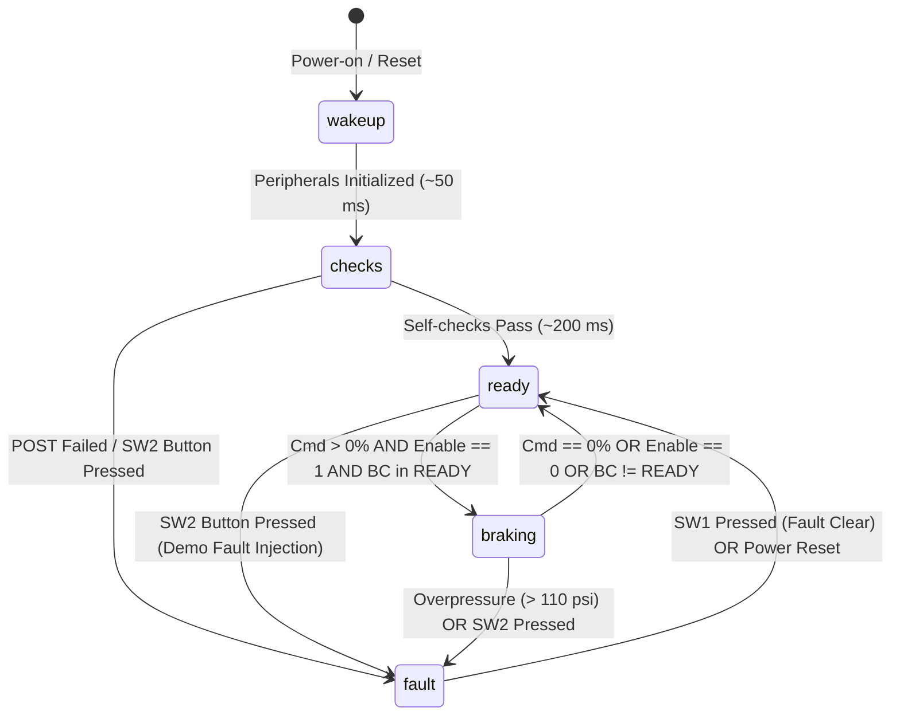
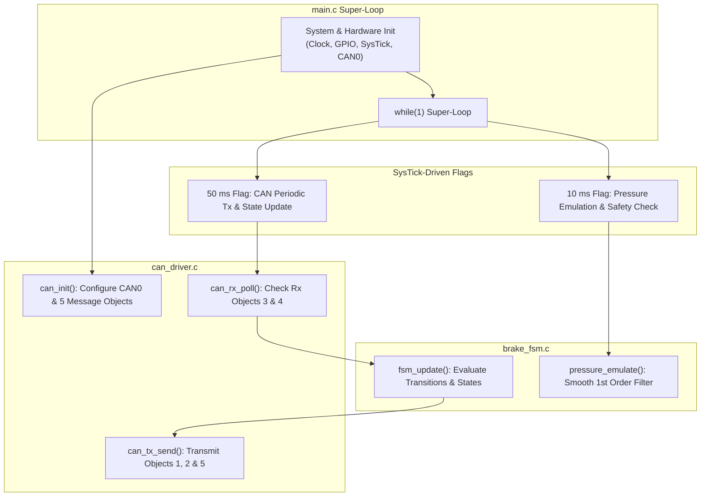

# TM4C123 Brake Controller Demo Requirements Specification (brake.md)

| Document Version | Status | Reference Baseline |
| :--- | :--- | :--- |
| **1.1.0 (Demo Baseline)** | **Approved for TM4C123 Implementation** | [constitution.md](file:///d:/projects/Agents/simbodybrake/constitution.md), [icd.md](file:///d:/projects/Agents/simbodybrake/icd.md), [body.md](file:///d:/projects/Agents/simbodybrake/body.md) |

---

## 1. System Overview & Scope

The **Brake Controller (BRK)** application is a lightweight embedded C program targeted for the **Texas Instruments Tiva C Series TM4C123G LaunchPad (`EK-TM4C123GXL` / `TM4C123GH6PM`)**. 

For the purposes of the system demonstration, the firmware implements:
1. A **5-state finite state machine** (`wakeup`, `checks`, `ready`, `braking`, `fault`).
2. **Low-level CAN communication** using the on-chip `CAN0` peripheral at **250 kbps** with cyclic **50 ms** messaging.
3. An **internal dynamic pressure emulation model** ($0\%\text{ -- }100\% \rightarrow 0.0\text{ -- }100.0\text{ psi}$) so the demo can execute on the LaunchPad without external hydraulic hardware.
4. **On-board LaunchPad visual indicators and test controls** (RGB LED for states, push-button SW2 for fault injection).

```mermaid
flowchart LR
    subgraph HostPC ["Host PC (Python Body Controller)"]
        BC_App["body_controller.py (Tkinter GUI)"]
        BC_HW["Vector CAN Interface (250 kbps)"]
        BC_App <--> BC_HW
    end

    subgraph CANBus ["CAN Bus (250 kbps, 50 ms Cycle)"]
        direction TB
        M1["0x100: BC_VehicleState (Rx)"]
        M2["0x101: BC_BrakeCommand (Rx)"]
        M3["0x200: BRK_StatusFeedback (Tx)"]
        M4["0x201: BRK_FaultStatus (Tx)"]
        M5["0x202: BRK_WarningStatus (Tx)"]
    end

    subgraph TM4C ["TI TM4C123G LaunchPad (Brake ECU)"]
        direction TB
        CAN_XCVR["3.3V CAN Transceiver (e.g., SN65HVD230)"]
        CAN0["TM4C123 CAN0 Peripheral (PB4/PB5)"]
        FSM["Brake FSM (5 States)"]
        EMU["Pressure Emulation Engine"]
        LEDS["RGB LED (PF1/PF2/PF3)"]
        SW["Fault Inject Button (SW2 / PF0)"]
        
        CAN_XCVR <--> CAN0
        CAN0 <--> FSM
        FSM <--> EMU
        FSM --> LEDS
        SW --> FSM
    end

    BC_HW <===> CANBus
    CANBus <===> CAN_XCVR
```



---

## 2. TM4C123 Hardware & Low-Level CAN Configuration

### 2.1 Hardware Specifications
| Parameter | Specification | TM4C123 Hardware Detail |
| :--- | :--- | :--- |
| **Microcontroller** | TI TM4C123GH6PM (ARM Cortex-M4F) | LaunchPad Board `EK-TM4C123GXL` |
| **System Clock** | **50 MHz** (or 80 MHz via PLL) | Configured using `SysCtlClockSet()` |
| **CAN Peripheral** | `CAN0` Module | Port B (`PB4` = CAN0Rx, `PB5` = CAN0Tx) or Port E (`PE4`/`PE5`) |
| **CAN Transceiver** | 3.3V CAN Transceiver | E.g. TI SN65HVD230, TCAN330, or VP230 |
| **Baud Rate** | **250 kbps** (250,000 bits/sec) | Configured via `CANBitRateSet()` |
| **Identifier Type** | **11-bit Standard Identifiers** | Classic CAN 2.0B |
| **Timing Base** | 1.0 ms SysTick Timer Interrupt | Drives 10 ms control & 50 ms CAN cyclic tasks |

### 2.2 Low-Level CAN0 Message Object Allocation
The TM4C123 CAN0 controller provides 32 hardware message objects. For this demo, 5 message objects are assigned:

| Message Object # | Direction | CAN ID (Hex) | DLC | Target Message / Purpose |
| :--- | :--- | :--- | :--- | :--- |
| **Object 1** | **Transmit (Tx)** | `0x200` | 4 | `BRK_StatusFeedback` (State, Pressure, Active Flag) |
| **Object 2** | **Transmit (Tx)** | `0x201` | 3 | `BRK_FaultStatus` (Fault Active, Fault Code, SubCode) |
| **Object 3** | **Receive (Rx)** | `0x100` | 3 | `BC_VehicleState` (Vehicle State, Fault State, Alive Counter, Temp) |
| **Object 4** | **Receive (Rx)** | `0x101` | 3 | `BC_BrakeCommand` (Command %, Enable Flag) |
| **Object 5** | **Transmit (Tx)** | `0x202` | 3 | `BRK_WarningStatus` (Warning Active, Degraded Mode, Max P) |

### 2.3 Hardware Requirements
- **REQ-BRK-HW-001 (Clock Setup)**: The TM4C123 shall configure the system clock to 50 MHz using the main crystal oscillator (16 MHz) and PLL.
- **REQ-BRK-HW-002 (CAN0 Initialization)**: The firmware shall initialize the `CAN0` peripheral, configure the CAN GPIO pins (PB4 as `CAN0Rx` and PB5 as `CAN0Tx`), and set the bus bit rate to **250 kbps**.
- **REQ-BRK-HW-003 (SysTick Scheduler)**: The firmware shall configure the ARM Cortex-M SysTick timer for a **1.0 ms** interrupt interval to drive periodic tasks without a heavy RTOS dependency.

---

## 3. Basic State Machine Specification

The state machine implements the 5 core states mandated by [constitution.md](file:///d:/projects/Agents/simbodybrake/constitution.md): `wakeup`, `checks`, `ready`, `braking`, and `fault`.



### 3.1 State Definitions & Transition Rules

| State Value | State Name | Entry / Steady Behavior | Transition Conditions | On-Board LED Color |
| :---: | :--- | :--- | :--- | :--- |
| `0` | `wakeup` | System boots; CAN, GPIO, and SysTick initialized; outputs forced to 0 psi. | Auto-advance to `checks` after $50\text{ ms}$. | White / Cyan |
| `1` | `checks` | Brief demo self-test routine ($200\text{ ms}$). | If SW2 pressed $\rightarrow$ `fault`. Else auto-advance to `ready`. | Yellow |
| `2` | `ready` | Quiescent state; target pressure held at $0.0\text{ psi}$; monitors CAN commands. | If `VehicleState == READY` (2) AND `Enable == 1` AND `Cmd > 0` $\rightarrow$ `braking`. If SW2 pressed $\rightarrow$ `fault`. | **Blue** |
| `3` | `braking` | Active braking; emulates pressure ramp to target ($0\text{--}100\text{ psi}$). | If `Cmd == 0` OR `Enable == 0` OR `VehicleState != READY` $\rightarrow$ `ready`. If $P > 110\text{ psi}$ or SW2 pressed $\rightarrow$ `fault`. | **Green** |
| `4` | `fault` | Fail-safe safe state; pressure forced to $0.0\text{ psi}$; asserts `0x201` fault frame. | Latched until SW1 button pressed to reset, or MCU power cycle. | **Red** |

### 3.2 State Machine Requirements
- **REQ-BRK-STATE-001 (wakeup)**: Upon reset, the TM4C123 shall hold `BrakeMachineState = 0` (`wakeup`) and initialize low-level hardware. It shall remain in `wakeup` for $50\text{ ms}$ before advancing to `checks`.
- **REQ-BRK-STATE-002 (checks)**: In `checks` (`BrakeMachineState = 1`), the controller executes a $200\text{ ms}$ simulated Power-On Self-Test (POST). Upon timer expiry, it shall advance to `ready`.
- **REQ-BRK-STATE-003 (ready)**: In `ready` (`BrakeMachineState = 2`), the target pressure is $0.0\text{ psi}$. When incoming CAN messages indicate `BC_VehicleState == READY` (2), `BrakeEnable == 1`, and `BrakeCommandPercent > 0`, the FSM shall transition to `braking`.
- **REQ-BRK-STATE-004 (braking)**: In `braking` (`BrakeMachineState = 3`), the controller regulates/emulates pressure toward $P_{\text{target}}$. When `BrakeCommandPercent == 0` or `BrakeEnable == 0`, it shall transition back to `ready`.
- **REQ-BRK-STATE-005 (fault)**: In `fault` (`BrakeMachineState = 4`), target pressure is clamped to $0.0\text{ psi}$, dynamic commands are rejected, and `BRK_FaultStatus` is transmitted with `FaultActive = 1`.

---

## 4. Low-Level CAN Rx/Tx Message Handling

All frames strictly follow the bit layouts defined in [icd.md](file:///d:/projects/Agents/simbodybrake/icd.md).

### 4.1 CAN Reception (Rx Tasks)

#### Message `0x100`: `BC_VehicleState` (DLC: 3)
- **Object 3 Configuration**: Filter ID = `0x100`, Mask = `0x7FF` (exact match).
- **REQ-BRK-CAN-RX-001 (Parse VehicleState & Heartbeat)**:
  ```c
  uint8_t vehicle_state  = rx_data[0] & 0x0F;        // 0: OFF, 1: STARTUP, 2: READY, 3: SHUTDOWN
  uint8_t bc_fault_state = (rx_data[0] >> 4) & 0x01; // 0: Normal, 1: BC pressure discrepancy fault active (REQ-BC-FLT-002)
  uint8_t alive_counter  = rx_data[1];               // 0..255
  int8_t  ambient_temp   = (int8_t)rx_data[2];       // -40..+85 degC
  ```
  - If `vehicle_state != 2` (`READY`), dynamic braking is inhibited and target pressure is set to $0\text{ psi}$.
- **REQ-BRK-CAN-RX-004 (Parse BC FaultState)**:
  The Brake Controller firmware shall evaluate `bc_fault_state` (Byte 0, bit 4) from `BC_VehicleState`. When asserted (`1`), the firmware logs/flags that the Body Controller has declared an active brake pressure discrepancy. When `vehicle_state` transitions to `OFF` (`0`) or `SHUTDOWN` (`3`), `bc_fault_state` resets to `0`.

- **REQ-BRK-THRM-001 (Ambient Temperature Derating & Degraded Mode)**:
  The firmware shall evaluate `ambient_temp` received in `BC_VehicleState` (`0x100` / Byte 2):
  - **Condition**: If `ambient_temp > 50` ($> 50^{\circ}\text{C}$):
    1. **Warning Message Active**: Set `warning_active = 1` in `BRK_WarningStatus` (`0x202`, Byte 0, bit 0).
    2. **Degraded Mode**: Set `degraded_mode = 0x1` (`REDUCED_CAPACITY`, Byte 0, bits 1-4).
    3. **Maximum Available Pressure**: Set `max_available_pressure_psi = 80.0` psi (encoded as raw integer `800` into Bytes 1-2 of `BRK_WarningStatus`).
    4. **Pressure Clamping**: The maximum allowable target brake pressure $P_{\text{target}}$ shall be clamped to **80.0 psi** ($P_{\text{target}} \le 80.0\text{ psi}$). Any command exceeding $80\%$ (e.g. $100\%$) shall be capped at $80.0\text{ psi}$.
  - **Recovery Condition**: When `ambient_temp <= 50` ($50^{\circ}\text{C}$, with optional $2^{\circ}\text{C}$ hysteresis clearing at $\le 48^{\circ}\text{C}$):
    1. Clear warning flag: `warning_active = 0`.
    2. Reset degraded mode: `degraded_mode = 0x0` (`NONE`).
    3. Restore full pressure capacity: `max_available_pressure_psi = 100.0` psi (raw `1000`).
    4. Restore nominal command range ($0.0\text{ -- }100.0\text{ psi}$).

#### Message `0x101`: `BC_BrakeCommand` (DLC: 3)
- **Object 4 Configuration**: Filter ID = `0x101`, Mask = `0x7FF` (exact match).
- **REQ-BRK-CAN-RX-002 (Parse BrakeCommand & Pressure Clamping)**:
  ```c
  uint8_t cmd_percent   = rx_data[0];              // 0..100%
  uint8_t brake_enable  = rx_data[1] & 0x01;       // 0: Disabled, 1: Enabled
  uint8_t cmd_counter   = rx_data[2];              // rolling counter
  ```
  - If `cmd_percent > 100`, clamp to 100.
  - If `brake_enable == 1` and `vehicle_state == 2`:
    ```c
    float requested_psi = (float)cmd_percent * 1.0f;
    if (requested_psi > max_available_pressure_psi) {
        requested_psi = max_available_pressure_psi; // Clamped to 80.0 psi if temp > 50 degC
    }
    p_target = requested_psi;
    ```
  - Else: $P_{\text{target}} = 0.0\text{ psi}$.

---

### 4.2 CAN Transmission (Tx Tasks)
Transmit messages (`0x200`, `0x201`, `0x202`) are broadcast periodically every **50 ms** using low-level TM4C123 CAN APIs.

#### Message `0x200`: `BRK_StatusFeedback` (DLC: 4)
- **Object 1 Configuration**: ID = `0x200`, DLC = 4.
- **REQ-BRK-CAN-TX-001 (Pack & Transmit Status)**:
  The 4-byte payload shall be constructed as:
  ```c
  uint16_t raw_pressure = (uint16_t)(actual_pressure_psi * 10.0f); // 0.1 psi/bit
  uint8_t  active_flag  = (actual_pressure_psi >= 2.0f) ? 1 : 0;

  tx_buf[0] = (uint8_t)(current_state & 0x0F);           // Byte 0: State (0..4)
  tx_buf[1] = (uint8_t)(raw_pressure & 0xFF);            // Byte 1: Pressure LSB
  tx_buf[2] = (uint8_t)((raw_pressure >> 8) & 0xFF);     // Byte 2: Pressure MSB
  tx_buf[3] = (uint8_t)(active_flag & 0x01);             // Byte 3: Active Flag
  ```

#### Message `0x201`: `BRK_FaultStatus` (DLC: 3)
- **Object 2 Configuration**: ID = `0x201`, DLC = 3.
- **REQ-BRK-CAN-TX-002 (Pack & Transmit Fault)**:
  The 3-byte payload shall be constructed as:
  ```c
  tx_buf[0] = (uint8_t)(fault_active & 0x01);            // Byte 0: Fault Active (1/0)
  tx_buf[1] = (uint8_t)fault_code;                       // Byte 1: Code (0x00..0x06)
  tx_buf[2] = (uint8_t)sub_error_code;                   // Byte 2: Sub-error diagnostic
  ```
  - Standard fault codes:
    - `0x00`: `NO_FAULT`
    - `0x01`: `SENSOR_FAULT`
    - `0x02`: `ACTUATOR_FAULT`
    - `0x04`: `SELFTEST_FAIL`
    - `0x05`: `UNDERPRESSURE_FAULT`
    - `0x06`: `OVERPRESSURE_FAULT`

#### Message `0x202`: `BRK_WarningStatus` (DLC: 3)
- **Object 5 Configuration**: ID = `0x202`, DLC = 3.
- **REQ-BRK-CAN-TX-003 (Pack & Transmit Warning / Degraded Status)**:
  The 3-byte payload communicates non-critical degraded operational modes and maximum pressure limits:
  ```c
  uint16_t raw_max_p = (uint16_t)(max_available_pressure_psi * 10.0f); // 0.1 psi/bit

  tx_buf[0] = (uint8_t)((warning_active & 0x01) | ((degraded_mode & 0x0F) << 1));
  tx_buf[1] = (uint8_t)(raw_max_p & 0xFF);         // Max Pressure LSB
  tx_buf[2] = (uint8_t)((raw_max_p >> 8) & 0xFF);  // Max Pressure MSB
  ```
  - Degraded modes:
    - `0x0`: `NONE` (Nominal, max pressure = 100.0 psi)
    - `0x1`: `REDUCED_CAPACITY` (Braking capacity limited to 80.0 psi when ambient temp > 50 deg C per `REQ-BRK-THRM-001`)
    - `0x2`: `OVERHEATED_DERATING` (Thermal protection active)
    - `0x3`: `SLOW_RESPONSE` (Dynamic pressure build rate degraded)
    - `0x4`: `BACKUP_CIRCUIT` (Operating on secondary hydraulic channel)

- **REQ-BRK-COMM-001 (Timeout Exclusion)**: CAN communication timeout / packet loss fault tripping is excluded from this demo phase, in accordance with [icd.md](file:///d:/projects/Agents/simbodybrake/icd.md).

---

## 5. Demo Pressure Emulation & Test Controls

To allow full bench demonstrations with only the TM4C123 LaunchPad and a PC CAN interface, hydraulic caliper pressure is emulated in firmware.

### 5.1 Pressure Emulation Engine (10 ms Task)
- **REQ-BRK-EMU-001 (Dynamic Response & Capacity Clamping)**: 
  The firmware shall update `actual_pressure_psi` every 10 ms toward $P_{\text{target}}$ using a simple first-order response:
  $$P_{\text{act}}[k] = P_{\text{act}}[k-1] + \alpha \left( P_{\text{target}} - P_{\text{act}}[k-1] \right)$$
  - Using $\alpha = 0.10$ ($10\text{ ms} / 100\text{ ms}$ time constant), a 0 to 50 psi step will smoothly ramp to $90\%$ within $\sim 200\text{ ms}$, providing an authentic visual rise curve on the PC GUI.
  - When degraded mode is active due to high ambient temperature ($> 50^{\circ}\text{C}$ per `REQ-BRK-THRM-001`), $P_{\text{target}}$ is capped at **80.0 psi**, preventing $P_{\text{act}}$ from exceeding 80.0 psi regardless of operator input.
- **REQ-BRK-EMU-002 (Brake Active Threshold)**:
  `BrakeActiveFlag` shall be set to `1` when $P_{\text{act}} \ge 2.0\text{ psi}$, and `0` when $P_{\text{act}} < 2.0\text{ psi}$.

### 5.2 LaunchPad Demo User Interface (LED & Buttons)
- **REQ-BRK-DEMO-001 (RGB State Visualizer)**:
  The firmware shall drive the TM4C123 onboard RGB LED (`PF1`=Red, `PF2`=Blue, `PF3`=Green) to reflect the operational state:
  - `ready`: **Solid Blue** (`PF2` ON)
  - `braking`: **Solid Green** (`PF3` ON)
  - `fault`: **Solid Red** (`PF1` ON)
  - `checks` / `wakeup`: **Cyan / Flashing** (`PF2 + PF3` ON)
- **REQ-BRK-DEMO-002 (Fault Injection via SW2)**:
  Pressing onboard switch `SW2` (`PF0` with internal pull-up) shall inject a demo fault:
  - Sets `fault_active = 1`, `fault_code = 0x01` (`SENSOR_FAULT`), and moves FSM to `fault`.
- **REQ-BRK-DEMO-003 (Fault Reset via SW1)**:
  Pressing onboard switch `SW1` (`PF4` with internal pull-up) while in `fault` state shall clear the fault and return the state machine to `ready`.

---

## 6. Software Architecture & Implementation Blueprint



### 6.1 Code Structure Outline
```
tm4c_brake_controller/
├── main.c              // Super-loop, SysTick handler, task dispatchers
├── can_driver.c/.h     // Low-level TivaWare CAN0 initialization, Tx and Rx routines
├── brake_fsm.c/.h      // 5-state state machine and state transition logic
├── pressure_emu.c/.h   // First-order hydraulic emulation model (10 ms)
├── led_sw.c/.h         // LaunchPad RGB LED and SW1/SW2 GPIO control
└── tm4c123gh6pm.h      // Device definitions / TivaWare headers
```

---

## 7. Requirements Traceability Matrix

| Requirement ID | Summary Description | Source in [constitution.md](file:///d:/projects/Agents/simbodybrake/constitution.md) | Source in [icd.md](file:///d:/projects/Agents/simbodybrake/icd.md) |
| :--- | :--- | :--- | :--- |
| `REQ-BRK-HW-001` .. `003` | TM4C123 50MHz clock, CAN0 at 250 kbps, 1ms SysTick | Line 2, 15 ("TI microcontroller") | Section 2 (250 kbps, Classic CAN) |
| `REQ-BRK-STATE-001` .. `005` | 5 States: wakeup, checks, ready, braking, fault | Line 17 ("state machine: wakeup, checks, ready, braking, fault") | Section 3.1, Section 4.2.3 |
| `REQ-BRK-CAN-RX-001` .. `004` | Low-level CAN Rx parsing for `0x100` (VehicleState & FaultState) and `0x101` | Line 15 ("receive brake commands") | Section 4.2.1, Section 4.2.2 |
| `REQ-BRK-CAN-TX-001` .. `003` | Low-level CAN Tx packing for `0x200`, `0x201`, and `0x202` (50 ms) | Line 15 ("send feedback... including current pressure and faults") | Section 4.2.3 .. 4.2.5 |
| `REQ-BRK-THRM-001` | High ambient temp (> 50 deg C) derating to Degraded Mode 0x1, Warning Active, 80 psi clamp | Line 26 ("warning") | Section 3.4 (Scenario D), Section 4.2.5 |
| `REQ-BRK-COMM-001` | CAN comm timeout out of scope | Implicit | Section 3.4 (Scenario C), Section 6 |
| `REQ-BRK-EMU-001` .. `002` | 0-100% $\rightarrow$ 0-100 psi emulation; $P \ge 2\text{ psi} \implies \text{Active}$ | Line 19 ("0-100% shall correspond to 0-100 psi") | Section 3.2, Section 4.2.3 |
| `REQ-BRK-DEMO-001` .. `003` | RGB LED state visualizer and SW1/SW2 fault buttons | Demo extension for TM4C123 LaunchPad | Section 3.4 (Diagnostic scenarios) |
