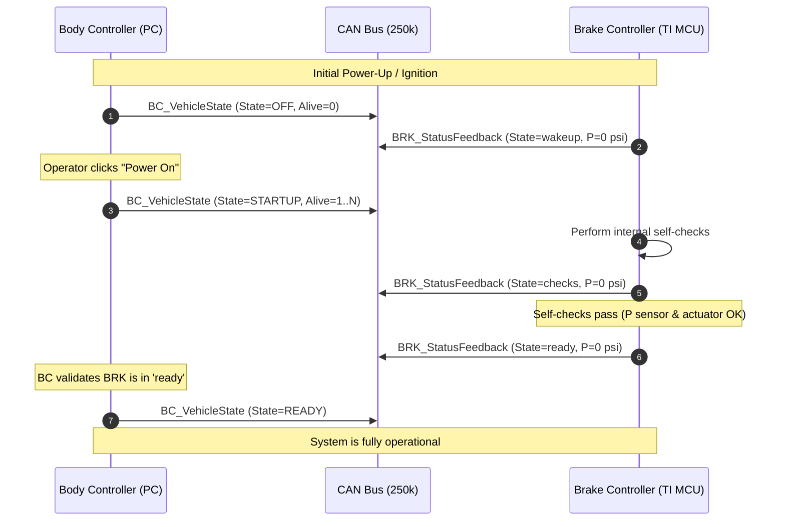
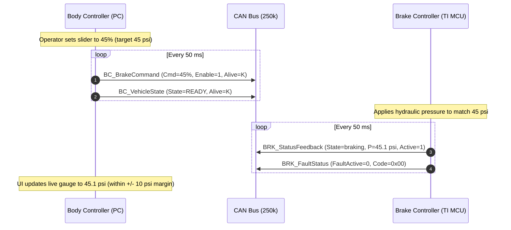
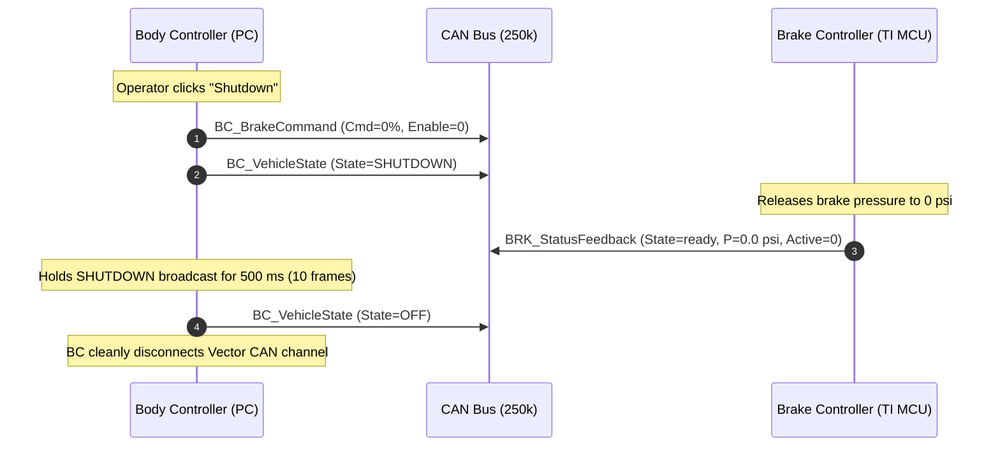
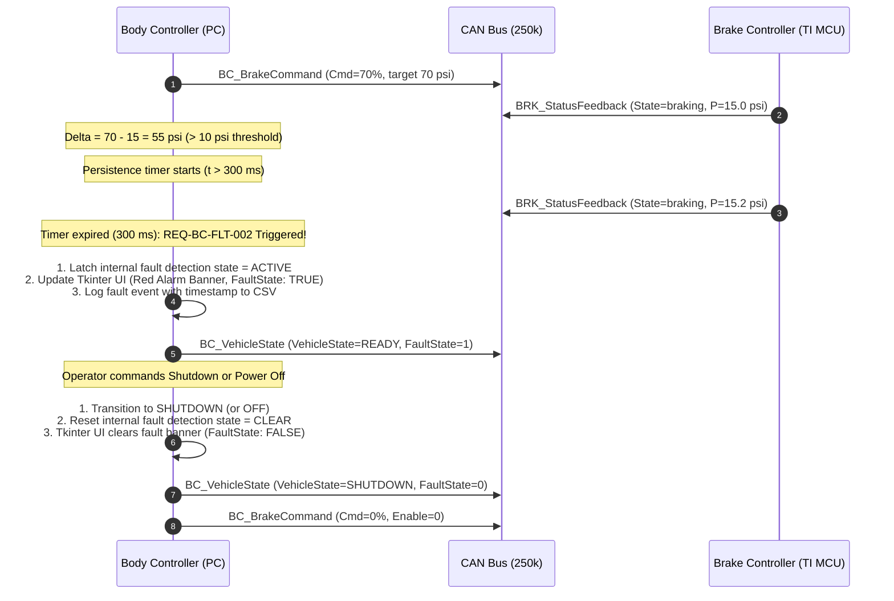
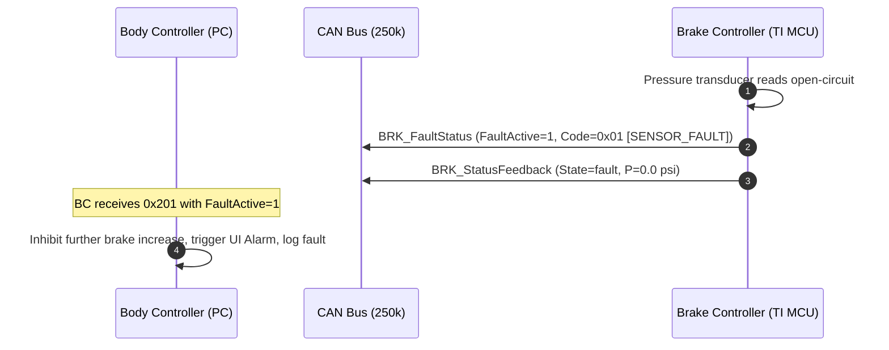
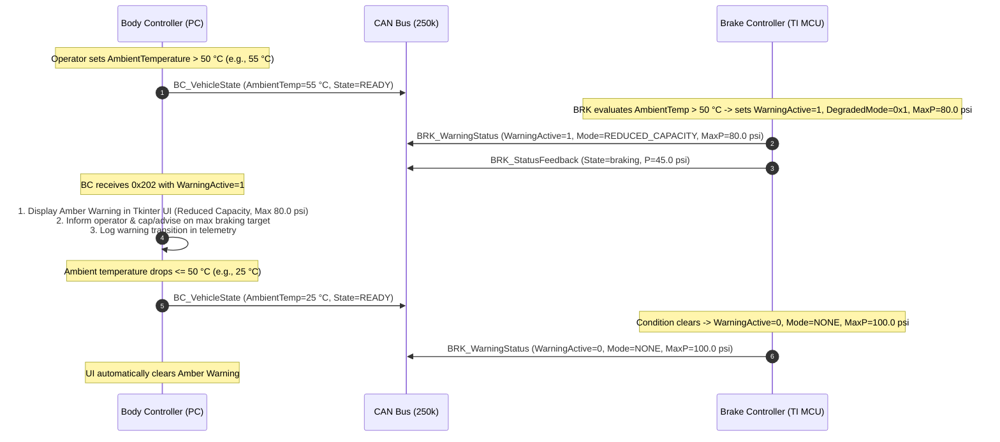

# Interface Control Document (ICD): Body Controller <-> Brake Controller

| Document Version | Status | Reference Documents |
| :--- | :--- | :--- |
| **1.0.0** | **Approved Baseline** | [constitution.md](file:///d:/projects/Agents/simbodybrake/constitution.md), [body.md](file:///d:/projects/Agents/simbodybrake/body.md), [brake.md](file:///d:/projects/Agents/simbodybrake/brake.md) |

---

## 1. Scope & System Interface Overview

This Interface Control Document (ICD) formally specifies the network architecture, physical layer parameters, communication protocol, message catalog, timing constraints, and interaction sequences between:
1. **Vehicle Body Controller (BC)**: Python supervisory application running on host PC (Windows) via Vector CAN hardware (Vector XL API).
2. **Brake Controller (BRK)**: Embedded C application executing on a Texas Instruments (TI) microcontroller.

```mermaid
flowchart LR
    subgraph HostPC ["Vehicle Body Controller (BC)"]
        BC_App["Python Body Controller"]
        BC_CAN["Vector CAN Hardware (XL API)"]
        BC_App <--> BC_CAN
    end

    subgraph CANBus ["Classic CAN Bus (ISO 11898-1: 250 kbps, 120 Ohm Terminated)"]
        direction TB
        M1["0x100: BC_VehicleState (50ms)"]
        M2["0x101: BC_BrakeCommand (50ms)"]
        M3["0x200: BRK_StatusFeedback (50ms)"]
        M4["0x201: BRK_FaultStatus (50ms/Event)"]
        M5["0x202: BRK_WarningStatus (50ms/Event)"]
    end

    subgraph TargetMCU ["Brake Controller (BRK)"]
        BRK_CAN["TI DCAN / MCAN Transceiver"]
        BRK_App["Embedded C Firmware"]
        BRK_CAN <--> BRK_App
    end

    BC_CAN <===> CANBus
    CANBus <===> BRK_CAN
```



### 1.1 Node Identifiers
| Node Name | Node Acronym | Role | Platform / Language | CAN Interface |
| :--- | :--- | :--- | :--- | :--- |
| **Vehicle Body Controller** | `BC` | Supervisory Master / HMI | PC (Python 3.10+) | Vector XL API (`python-can`) |
| **Brake Controller** | `BRK` | Actuator Slave / Safety ECU | TI MCU (C Firmware) | On-chip CAN Controller |

---

## 2. Physical & Data Link Layer Specifications

| Parameter | Specification | Compliance / Notes |
| :--- | :--- | :--- |
| **Standard** | ISO 11898-1:2015 (Classic CAN 2.0B) | Non-FD Classic Frames |
| **Baud Rate** | **250 kbps** (250,000 bits/sec) | Nominal Bit Time = \(4.0\text{ }\mu\text{s}\) |
| **Bit Timing / Sample Point** | 75% to 80% nominal sample point | Standard automotive setting |
| **Identifier Format** | **11-bit Standard Identifiers** | Base frame format (`0x000` to `0x7FF`) |
| **Payload Size (DLC)** | Fixed per message (up to 8 bytes) | Zero-padding unused bytes to DLC |
| **Byte Ordering (Endianness)** | **Intel (Little-Endian)** | Least significant byte at lowest address |
| **Transmission Mode** | Periodic Cyclic Broadcast | Refresh rate = **50 ms** (\(20\text{ Hz}\)) |
| **Bus Termination** | Split termination (\(120\text{ }\Omega\) at both line ends) | Standard high-speed physical layer |

---

## 3. Communication Interaction Sequences

### 3.1 System Startup & Handshake Sequence
The Body Controller coordinates the system boot-up, while the Brake Controller transitions through hardware diagnostic checks before entering active operation.



### 3.2 Dynamic Brake Command & Feedback Sequence
In the `READY` state, the operator commands braking through the Body Controller GUI. Commanded percentage ($0\%\text{ -- }100\%$) translates directly to target pressure ($0\text{ -- }100\text{ psi}$).



### 3.3 Normal Shutdown Sequence


### 3.4 Fault Handling Sequences

#### Scenario A: Brake Pressure Below Commanded Threshold (Brake Failure)


#### Scenario B: Microcontroller Internal Fault (Sensor/Hardware)


#### Scenario C: Loss of Communication (CAN Timeout - Out of Scope / Deferred)
- Note: CAN timeout and communication loss fault detection are explicitly not required in the current system phase.
- Neither controller is required to declare a fault or transition operational modes due to absent or delayed periodic messages.

#### Scenario D: Brake Controller Degraded State Warning (e.g., High Ambient Temperature > 50 °C)


---

## 4. CAN Message Catalog & Signal Dictionary

### 4.1 Message Summary Table

| Message Name | CAN ID (Hex) | CAN ID (Dec) | Transmitter | Receiver | Cycle Time | DLC | Priority |
| :--- | :--- | :--- | :--- | :--- | :--- | :--- | :--- |
| **`BC_VehicleState`** | `0x100` | 256 | `BC` | `BRK` | 50 ms | 3 | High |
| **`BC_BrakeCommand`** | `0x101` | 257 | `BC` | `BRK` | 50 ms | 3 | High |
| **`BRK_StatusFeedback`** | `0x200` | 512 | `BRK` | `BC` | 50 ms | 4 | Medium |
| **`BRK_FaultStatus`** | `0x201` | 513 | `BRK` | `BC` | 50 ms / Event | 3 | High |
| **`BRK_WarningStatus`** | `0x202` | 514 | `BRK` | `BC` | 50 ms / Event | 3 | Medium-High |

---

### 4.2 Message Detailed Specifications

#### 4.2.1 `BC_VehicleState` (`0x100`)
Broadcast by the Body Controller to communicate the vehicle supervisor state, fault state flag, rolling heartbeat counter, and ambient temperature.

- **CAN ID**: `0x100` (11-bit standard)
- **Period**: 50 ms ($\pm 5\text{ ms}$)
- **DLC**: 3 bytes
- **Payload Layout**:

```
Byte 0: [  Res (3b)  | FaultState (1b) | VehicleState (4b) ]
Byte 1: [                 BC_AliveCounter (8b)             ]
Byte 2: [               AmbientTemperature (8b)            ]
```

- **Signal Details**:

| Signal Name | Start Bit | Length | Byte Order | Type | Factor | Offset | Min | Max | Unit | Description / Value Table |
| :--- | :--- | :--- | :--- | :--- | :--- | :--- | :--- | :--- | :--- | :--- |
| `VehicleState` | 0 | 4 | Intel | Unsigned | 1 | 0 | 0 | 3 | Enum | `0`: `OFF`<br/>`1`: `STARTUP`<br/>`2`: `READY`<br/>`3`: `SHUTDOWN`<br/>`4-15`: `Reserved` |
| `FaultState` | 4 | 1 | Intel | Boolean | 1 | 0 | 0 | 1 | Flag | `0`: `False` (Normal / No brake discrepancy fault)<br/>`1`: `True` (Brake fault active - REQ-BC-FLT-002). Resets to `0` when `VehicleState` transitions to `OFF` or `SHUTDOWN`. |
| `BC_Reserved` | 5 | 3 | Intel | Unsigned | 1 | 0 | 0 | 7 | - | Reserved (set to `0`) |
| `BC_AliveCounter` | 8 | 8 | Intel | Unsigned | 1 | 0 | 0 | 255 | count | Rolling counter ($0 \rightarrow 255 \rightarrow 0$), increments every 50 ms |
| `AmbientTemperature` | 16 | 8 | Intel | Signed (`int8`) | 1 | 0 | -40 | 85 | degC | Ambient temperature configured via Body Controller UI (default $25^{\circ}\text{C}$, range $-40^{\circ}\text{C}$ to $+85^{\circ}\text{C}$) |

---

#### 4.2.2 `BC_BrakeCommand` (`0x101`)
Transmits the operator's commanded brake percentage and safety enable flags.

- **CAN ID**: `0x101` (11-bit standard)
- **Period**: 50 ms ($\pm 5\text{ ms}$)
- **DLC**: 3 bytes
- **Payload Layout**:

```
Byte 0: [     BrakeCommandPercent (8b)     ]
Byte 1: [  Res (7b)  |  BrakeEnable (1b)   ]
Byte 2: [      BC_CmdRollingCounter (8b)   ]
```

- **Signal Details**:

| Signal Name | Start Bit | Length | Byte Order | Type | Factor | Offset | Min | Max | Unit | Description / Value Table |
| :--- | :--- | :--- | :--- | :--- | :--- | :--- | :--- | :--- | :--- | :--- |
| `BrakeCommandPercent` | 0 | 8 | Intel | Unsigned | 1 | 0 | 0 | 100 | % | Operator brake command ($0\% = \text{no braking}$, $100\% = \text{full braking}$). Corresponds to $0\text{ -- }100\text{ psi}$. Values $>100$ rejected as invalid. |
| `BrakeEnable` | 8 | 1 | Intel | Boolean | 1 | 0 | 0 | 1 | Flag | `0`: Inhibit command (force 0 psi)<br/>`1`: Brake actuation enabled |
| `CmdReserved` | 9 | 7 | Intel | Unsigned | 1 | 0 | 0 | 127 | - | Reserved (set to `0`) |
| `BC_CmdRollingCounter` | 16 | 8 | Intel | Unsigned | 1 | 0 | 0 | 255 | count | Rolling counter for command freshness validation |

---

#### 4.2.3 `BRK_StatusFeedback` (`0x200`)
Broadcast by the Brake Controller to report current operating mode, measured line pressure, and mechanical status.

- **CAN ID**: `0x200` (11-bit standard)
- **Period**: 50 ms ($\pm 5\text{ ms}$)
- **DLC**: 4 bytes
- **Payload Layout**:

```
Byte 0: [  Res (4b)  | BrakeMachineState (4b) ]
Byte 1: [     ActualBrakePressure [7:0]       ] (LSB)
Byte 2: [     ActualBrakePressure [15:8]      ] (MSB)
Byte 3: [  Res (7b)  |  BrakeActiveFlag (1b)  ]
```

- **Signal Details**:

| Signal Name | Start Bit | Length | Byte Order | Type | Factor | Offset | Min | Max | Unit | Description / Value Table |
| :--- | :--- | :--- | :--- | :--- | :--- | :--- | :--- | :--- | :--- | :--- |
| `BrakeMachineState` | 0 | 4 | Intel | Unsigned | 1 | 0 | 0 | 4 | Enum | `0`: `wakeup`<br/>`1`: `checks`<br/>`2`: `ready`<br/>`3`: `braking`<br/>`4`: `fault`<br/>`5-15`: `Reserved` |
| `BRK_Reserved0` | 4 | 4 | Intel | Unsigned | 1 | 0 | 0 | 15 | - | Reserved |
| `ActualBrakePressure` | 8 | 16 | Intel | Unsigned | 0.1 | 0 | 0.0 | 120.0 | psi | Measured brake line hydraulic pressure ($0.1\text{ psi/LSB}$). Nominal range $0.0\text{ -- }100.0\text{ psi}$. Raw values $0\text{ -- }1200$. |
| `BrakeActiveFlag` | 24 | 1 | Intel | Boolean | 1 | 0 | 0 | 1 | Flag | `0`: Calipers open / pressure $< 2\text{ psi}$<br/>`1`: Calipers clamped / active braking |
| `BRK_Reserved1` | 25 | 7 | Intel | Unsigned | 1 | 0 | 0 | 127 | - | Reserved |

---

#### 4.2.4 `BRK_FaultStatus` (`0x201`)
Dedicated fault message transmitted by the Brake Controller to report system faults, component failures, and diagnostic codes.

- **CAN ID**: `0x201` (11-bit standard)
- **Period**: 50 ms periodic (or broadcast immediately on state transition)
- **DLC**: 3 bytes
- **Payload Layout**:

```
Byte 0: [  Res (7b)  |  FaultActive (1b)     ]
Byte 1: [           FaultCode (8b)           ]
Byte 2: [         SubErrorCode (8b)          ]
```

- **Signal Details**:

| Signal Name | Start Bit | Length | Byte Order | Type | Factor | Offset | Min | Max | Unit | Description / Value Table |
| :--- | :--- | :--- | :--- | :--- | :--- | :--- | :--- | :--- | :--- | :--- |
| `FaultActive` | 0 | 1 | Intel | Boolean | 1 | 0 | 0 | 1 | Flag | `0`: Normal operation (no active faults)<br/>`1`: Fault active |
| `FaultReserved` | 1 | 7 | Intel | Unsigned | 1 | 0 | 0 | 127 | - | Reserved |
| `FaultCode` | 8 | 8 | Intel | Unsigned | 1 | 0 | 0 | 255 | Enum | `0x00`: `NO_FAULT`<br/>`0x01`: `SENSOR_FAULT` (pressure transducer out of bounds)<br/>`0x02`: `ACTUATOR_FAULT` (valve/pump drive error)<br/>`0x03`: `COMMS_TIMEOUT` (Reserved / Not used in current phase)<br/>`0x04`: `SELFTEST_FAIL` (startup checks failed)<br/>`0x05`: `UNDERPRESSURE_FAULT` (unable to build pressure)<br/>`0x06`: `OVERPRESSURE_FAULT` ($>110\text{ psi}$ safety limit) |
| `SubErrorCode` | 16 | 8 | Intel | Unsigned | 1 | 0 | 0 | 255 | Hex | Detailed diagnostic register value for debugger/analysis |

---

#### 4.2.5 `BRK_WarningStatus` (`0x202`)
Broadcast by the Brake Controller to communicate non-critical degraded operational states, thermal derating, backup channel modes, and maximum available braking capacity.

- **CAN ID**: `0x202` (11-bit standard)
- **Period**: 50 ms periodic (or broadcast on warning state change)
- **DLC**: 3 bytes
- **Payload Layout**:

```
Byte 0: [  Res (3b)  | DegradedMode (4b) | WarningActive (1b) ]
Byte 1: [        MaxAvailablePressure [7:0]                  ] (LSB)
Byte 2: [        MaxAvailablePressure [15:8]                 ] (MSB)
```

- **Signal Details**:

| Signal Name | Start Bit | Length | Byte Order | Type | Factor | Offset | Min | Max | Unit | Description / Value Table |
| :--- | :--- | :--- | :--- | :--- | :--- | :--- | :--- | :--- | :--- | :--- |
| `WarningActive` | 0 | 1 | Intel | Boolean | 1 | 0 | 0 | 1 | Flag | `0`: Nominal operation (no active warnings)<br/>`1`: Degraded state warning active |
| `DegradedMode` | 1 | 4 | Intel | Unsigned | 1 | 0 | 0 | 15 | Enum | `0x0`: `NONE` (Nominal)<br/>`0x1`: `REDUCED_CAPACITY` (Braking capacity capped)<br/>`0x2`: `OVERHEATED_DERATING` (Thermal protection derating)<br/>`0x3`: `SLOW_RESPONSE` (Dynamic pressure build rate degraded)<br/>`0x4`: `BACKUP_CIRCUIT` (Operating on secondary hydraulic channel)<br/>`0x5-0xF`: `Reserved` |
| `WarnReserved` | 5 | 3 | Intel | Unsigned | 1 | 0 | 0 | 7 | - | Reserved (set to `0`) |
| `MaxAvailablePressure` | 8 | 16 | Intel | Unsigned | 0.1 | 0 | 0.0 | 120.0 | psi | Maximum achievable pressure under current degraded mode ($0.1\text{ psi/LSB}$). Nominal $100.0\text{ psi}$ when non-degraded. |

---

## 5. Formal DBC (CAN Database) Definitions

To enable automated code generation, Vector CANoe / CANalyzer integration, and Python `cantools` decoding, the interface is codified into standard DBC format.

### 5.1 DBC: Vehicle State & Commands (`vehicle_state.dbc`)

```
VERSION "1.0"

NS_ :
    NS_DESC_
    CM_
    BA_DEF_
    BA_
    VAL_
    CAT_DEF_
    CAT_
    FILTER
    BA_DEF_DEF_
    EV_DATA_
    ENVVAR_DATA_
    SGTYPE_
    SGTYPE_VAL_
    BA_DEF_SGTYPE_
    BA_SGTYPE_
    SIG_TYPE_REF_
    VAL_TABLE_
    SIG_GROUP_
    SIG_VALTYPE_
    SIGTYPE_VALTYPE_
    BO_TX_BU_
    BA_DEF_REL_
    BA_REL_
    BA_DEF_DEF_REL_
    BU_SG_REL_
    BU_EV_REL_
    BU_BO_REL_
    SG_MUL_VAL_

BS_:

BU_: BC BRK

BO_ 256 BC_VehicleState: 3 BC
 SG_ VehicleState : 0|4@1+ (1,0) [0|3] "" BRK
 SG_ FaultState : 4|1@1+ (1,0) [0|1] "" BRK
 SG_ BC_Reserved : 5|3@1+ (1,0) [0|7] "" BRK
 SG_ BC_AliveCounter : 8|8@1+ (1,0) [0|255] "count" BRK
 SG_ AmbientTemperature : 16|8@1- (1,0) [-40|85] "degC" BRK

BO_ 257 BC_BrakeCommand: 3 BC
 SG_ BrakeCommandPercent : 0|8@1+ (1,0) [0|100] "%" BRK
 SG_ BrakeEnable : 8|1@1+ (1,0) [0|1] "" BRK
 SG_ CmdReserved : 9|7@1+ (1,0) [0|127] "" BRK
 SG_ BC_CmdRollingCounter : 16|8@1+ (1,0) [0|255] "count" BRK

VAL_ 256 VehicleState 0 "OFF" 1 "STARTUP" 2 "READY" 3 "SHUTDOWN" ;
VAL_ 256 FaultState 0 "Normal" 1 "FaultActive" ;
VAL_ 257 BrakeEnable 0 "Disabled" 1 "Enabled" ;
```

---

### 5.2 DBC: Vehicle Brake Feedback & Diagnostics (`vehicle_brake.dbc`)

```
VERSION "1.0"

NS_ :
    NS_DESC_
    CM_
    BA_DEF_
    BA_
    VAL_
    CAT_DEF_
    CAT_
    FILTER
    BA_DEF_DEF_
    EV_DATA_
    ENVVAR_DATA_
    SGTYPE_
    SGTYPE_VAL_
    BA_DEF_SGTYPE_
    BA_SGTYPE_
    SIG_TYPE_REF_
    VAL_TABLE_
    SIG_GROUP_
    SIG_VALTYPE_
    SIGTYPE_VALTYPE_
    BO_TX_BU_
    BA_DEF_REL_
    BA_REL_
    BA_DEF_DEF_REL_
    BU_SG_REL_
    BU_EV_REL_
    BU_BO_REL_
    SG_MUL_VAL_

BS_:

BU_: BRK BC

BO_ 512 BRK_StatusFeedback: 4 BRK
 SG_ BrakeMachineState : 0|4@1+ (1,0) [0|4] "" BC
 SG_ BRK_Reserved0 : 4|4@1+ (1,0) [0|15] "" BC
 SG_ ActualBrakePressure : 8|16@1+ (0.1,0) [0|120] "psi" BC
 SG_ BrakeActiveFlag : 24|1@1+ (1,0) [0|1] "" BC
 SG_ BRK_Reserved1 : 25|7@1+ (1,0) [0|127] "" BC

BO_ 513 BRK_FaultStatus: 3 BRK
 SG_ FaultActive : 0|1@1+ (1,0) [0|1] "" BC
 SG_ FaultReserved : 1|7@1+ (1,0) [0|127] "" BC
 SG_ FaultCode : 8|8@1+ (1,0) [0|255] "" BC
 SG_ SubErrorCode : 16|8@1+ (1,0) [0|255] "hex" BC

BO_ 514 BRK_WarningStatus: 3 BRK
 SG_ WarningActive : 0|1@1+ (1,0) [0|1] "" BC
 SG_ DegradedMode : 1|4@1+ (1,0) [0|15] "" BC
 SG_ WarnReserved : 5|3@1+ (1,0) [0|7] "" BC
 SG_ MaxAvailablePressure : 8|16@1+ (0.1,0) [0|120] "psi" BC

VAL_ 512 BrakeMachineState 0 "wakeup" 1 "checks" 2 "ready" 3 "braking" 4 "fault" ;
VAL_ 512 BrakeActiveFlag 0 "Inactive" 1 "Active" ;
VAL_ 513 FaultActive 0 "Normal" 1 "FaultPresent" ;
VAL_ 513 FaultCode 0 "NO_FAULT" 1 "SENSOR_FAULT" 2 "ACTUATOR_FAULT" 3 "COMMS_TIMEOUT" 4 "SELFTEST_FAIL" 5 "UNDERPRESSURE" 6 "OVERPRESSURE" ;
VAL_ 514 WarningActive 0 "Normal" 1 "WarningActive" ;
VAL_ 514 DegradedMode 0 "NONE" 1 "REDUCED_CAPACITY" 2 "OVERHEATED_DERATING" 3 "SLOW_RESPONSE" 4 "BACKUP_CIRCUIT" ;
```

---

## 6. Timing, Tolerances & Diagnostics Matrix

| Parameter | Value | Tolerance | Fail-Safe Reaction |
| :--- | :--- | :--- | :--- |
| **Transmit Periodicity (Tx)** | 50.0 ms | $\pm 5.0\text{ ms}$ | Log jitter warning if $>60\text{ ms}$ |
| **Timeout Threshold (Rx Loss)** | N/A (Deferred) | Currently not required | No fault declared on missing frames in current phase |
| **Startup Handshake Timeout** | 2000.0 ms | Max wait | BC aborts to `OFF`; indicates startup fault |
| **Shutdown Persistence** | 500.0 ms | 10 cycles min | Ensures BRK acknowledges 0 psi before bus disconnect |
| **Pressure Tracking Margin ($\Delta P$)** | 10.0 psi | Hysteresis 2.0 psi | Trigger warning if $P_{\text{cmd}} - P_{\text{act}} > 10\text{ psi}$ |
| **Pressure Debounce Filter** | 300.0 ms | 6 cycles | Prevents false alarms during rapid hydraulic ramp-up |
| **Degraded Warning Latency** | $\le 100.0\text{ ms}$ | Within 2 cycles | Display amber banner on BC UI, clamp/advise available pressure |

---

## 7. Change Control & Verification Traceability

| ICD Section | Correlated Section in [body.md](file:///d:/projects/Agents/simbodybrake/body.md) | Correlated Section in [brake.md](file:///d:/projects/Agents/simbodybrake/brake.md) | Correlated Section in [constitution.md](file:///d:/projects/Agents/simbodybrake/constitution.md) |
| :--- | :--- | :--- | :--- |
| Section 2 (Physical Layer) | `REQ-BC-HW-001` .. `002` | `REQ-BRK-HW-001` .. `003` | Section 1 (CAN bus communication) |
| Section 3 (Interaction Sequences) | `REQ-BC-STATE-001` .. `004` | `REQ-BRK-STATE-001` .. `005` | Lines 6-13, 17 (States & Handshakes) |
| Section 4 (Message Catalog) | `REQ-BC-CAN-001` .. `004` | `REQ-BRK-CAN-TX-001` .. `007`, `REQ-BRK-CAN-RX-001` .. `005` | Lines 21-28 (ICD Elements) |
| Section 5 (DBC Definitions) | Section 5 (CAN ICD) | Section 5 (CAN Specification) | Lines 30-32 (DBC vehicle brake & state) |
| Section 6 (Timing & Diagnostics) | `REQ-BC-FLT-001` .. `004` | `REQ-BRK-DIAG-001` .. `004`, `REQ-BRK-COMM-001` | Lines 11-13, 19 (Fault & Pressure Mapping) |
